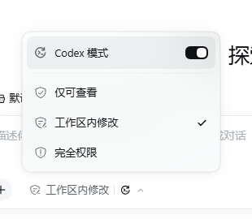
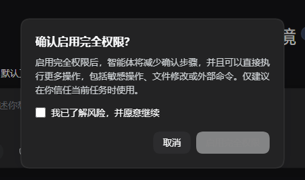
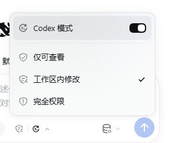

# Codex Mode for DeepSeek Harness

A Codex-style execution mode for DSH. It adds a switch at the top of the
permission menu, keeps a durable plan, emits visible progress while tools run,
and continues a turn that stops with unfinished work.

The important difference from a prompt-only mode: if the model emits a tool call
without text, the host driver commits a short progress message **before** the
tool runs, as part of the durable assistant message. A long turn is not a silent
tool loop.



## What it does

- **Codex switch** at the top of the permission menu, above a divider. The
  switch does not change the sandbox or approval level.
- **Visible progress** before every tool batch. The model's own commentary is
  kept; a missing one is inserted by the driver in the user's language.
- **Turn continuation** when the todo list still has unfinished work and the
  assistant is not asking a question.
- **Durable state** stored as a permission-preset identity
  (`codex-read-only`, `codex-workspace-write`, `codex-danger-full-access`), so
  it survives reload and resume and appears in the session log.
- **Same safety gates** for Full access and Auto review as the stock permission
  control.

## Requirements

- DSH Desktop or Web with the Plugin Manager. Tested with DSH `0.2.1-rc.3`.
- The package declares `engines.dsh: ^0.2.1-rc.1`; install it on a 0.2.1-rc.x
  runtime.
- Git and network access to GitHub for the first install.

## Install

### Option 1: give DSH the GitHub link

Start a new DSH session and send:

```text
Install this DSH plugin bundle from GitHub: https://github.com/airainal/dsh-codex-mode
```

The agent can call the `plugin_manager` tool with that URL. The manager checks
the GitHub repository, installs the bundle, and enables it. You can also open
**Plugins → Install bundle** and paste:

```text
https://github.com/airainal/dsh-codex-mode
```

If your DSH version wants an explicit git spec, use:

```text
github:airainal/dsh-codex-mode
```

### Option 2: install the release tarball

Download the asset from
[Releases](https://github.com/airainal/dsh-codex-mode/releases) and paste either
the release asset URL or the downloaded `.tgz` path into **Plugins → Install
bundle**:

```text
https://github.com/airainal/dsh-codex-mode/releases/download/v1.0.0/dsh-codex-mode-1.0.0.tgz
```

### After installing

1. Open any session.
2. Click the permission control at the bottom of the composer.
3. Turn on **Codex Mode** at the top of the menu.
4. Pick `Read Only`, `Workspace Write`, or `Full access` exactly as before. The
   mode and the permission level are independent.

HMR applies the change immediately in the desktop app. If your profile has HMR
disabled, restart DSH after installation.

To remove it, open **Plugins → Codex Mode → Remove**, or ask the agent to remove
the bundle.

## Use

The menu has two dimensions:

- the Codex switch controls the execution protocol;
- the permission choices control the sandbox and approval policy.

Turning Codex on while `Workspace Write` is selected moves the session to the
matching `codex-workspace-write` identity, but the sandbox stays
`workspace-write`. Changing permission while the mode is on keeps the mode and
moves to the matching `codex-*` variant.

The trigger shows a Codex mark on the right when the mode is on. It slides out
with a 240 ms width/opacity transition, and the menu stays open while switching.

## How it works

The package is a DSH bundle with a Host half and a Web client half.

- `cordis.patch.yml` adds the three `codex-*` permission presets and mounts the
  Host plugin.
- The Host plugin adds the `codex:mode` system-prompt section and wraps each
  live agent's step. In Codex mode, an `assistant/message` that contains only
  tool calls gets a leading progress text block before it is committed; the
  matching `text-chunks` record is added to the stream and tool-call block
  indexes are shifted so content and stream stay aligned.
- `agent/turn-stopping` provides one continuation steer when the plan is
  unfinished and the reply is not a question.
- The Client plugin replaces the current-session permission control with the
  same control plus the Codex row, keeping the original permission glyphs and
  the Full-access/Auto-review risk dialogs.

This is a Codex **step driver**, not a second tool runtime. DSH still owns turn
construction, tool dispatch, approvals, retries, compaction, and the event log.
A full fork of those systems would duplicate a large amount of tested
infrastructure; the driver changes the part users actually see: progress output
and turn continuation.

### Why the progress line is provable

The line is not a UI status chip. In a test turn that explicitly told the model
not to emit text, the model's stream contained only reasoning and tool-call
chunks, with no `text-chunks`. The committed assistant message was:

```text
[reasoning, "我先读取 `dsh-codex-mode/client.js`。", tool-call]
```

The matching stream indexes were reasoning `0`, text `1`, tool-call `2`. The
text could only come from the Host driver. The test was run locally against DSH
`0.2.1-rc.3`; the session log itself is not published.

## Scope and limitations

- The package targets DSH `0.2.1-rc.x`. It uses the live agent's `step` and the
  session append boundary; a future DSH release can change those internals.
- It is not a complete Codex engine. Freeform `apply_patch`, Codex-style
  one-tool scheduling, shell/output limits, and Codex compaction thresholds are
  not implemented.
- The bundle overrides the `permission` row to add the `codex-*` presets. If you
  maintain custom permission presets in a profile, carry them into
  [cordis.patch.yml](cordis.patch.yml) before installing.
- The built-in `/permission` command also lists the `codex-*` identities. Use the
  composer menu for the intended two-dimensional behavior.
- The Settings default-permission selector lists the `codex-*` presets because
  they are ordinary permission presets; the composer menu is the intended place
  to switch a running session.

## Screenshots

| Menu, light | Trigger |
|---|---|
|  |  |

| Dark risk gate | Narrow layout |
|---|---|
|  |  |

## Development

There is no build step.

```bash
git clone https://github.com/airainal/dsh-codex-mode.git
cd dsh-codex-mode
```

Install the directory as a bundle through **Plugins → Install bundle**, or ask a
DSH agent to install that path with `plugin_manager`. The Host plugin exports
`apply()`, the client is a plain `window.__ModuleLoader__` module, and the bundle
patch is `cordis.patch.yml`.

To build the release tarball:

```bash
pnpm pack
```

## 中文快速安装

把下面这句直接发给新的 DSH 会话：

```text
安装这个 DSH 插件 bundle：https://github.com/airainal/dsh-codex-mode
```

装好后打开任意会话，点输入框下方的权限按钮，在菜单顶部打开 **Codex 模式**。
权限级别不会改变；Codex 模式关闭时，行为与原生 DSH 一致。

## License

MIT. See [LICENSE](LICENSE).
